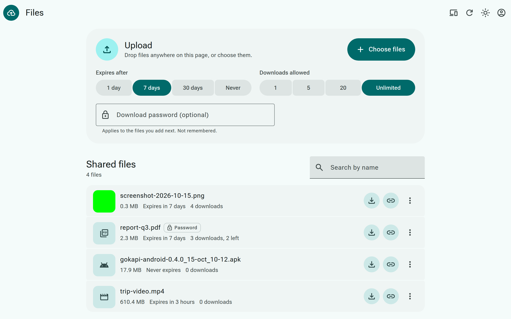
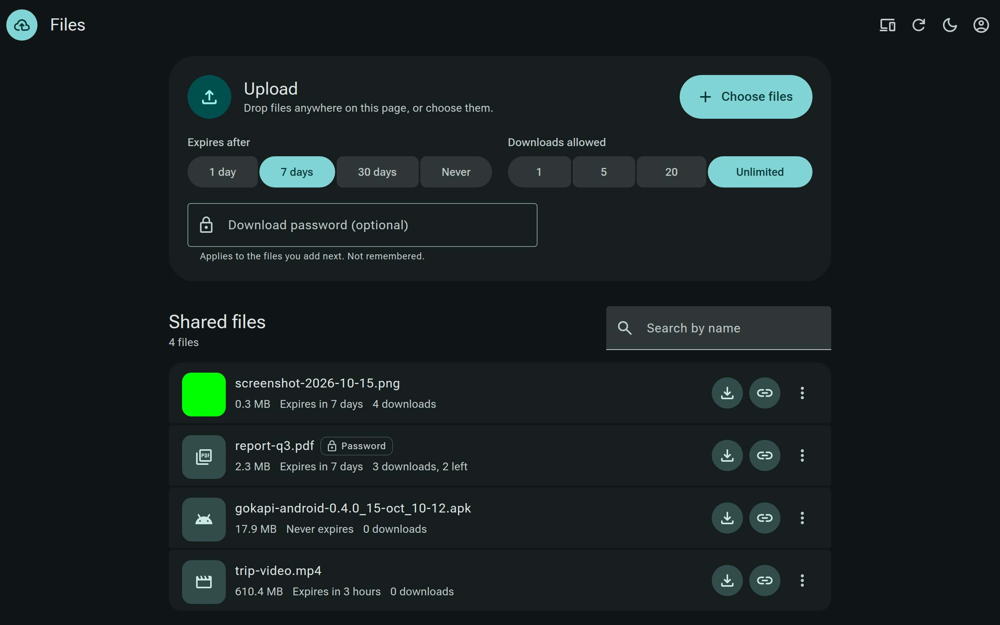

# gokapi-admin

A Material 3 Expressive web UI for the private Gokapi in
`~/dotconfig/_home/docker/files`. It replaces Gokapi's own admin page for
everyday use: upload with drag and drop, list, search, copy links, QR codes,
edit downloads, expiry, and password, and delete with undo.

It is a separate app. Gokapi and its own `/admin` page keep working whether
or not this app is installed or running.



<details>
<summary>Dark mode</summary>



</details>

The screenshots use the mock Gokapi (`scripts/mock-gokapi.mjs`) and its
dummy files. No real data is shown.

> [!WARNING]
> Keep this app on a private network such as a tailnet or a LAN. Don't
> expose it to the public internet. The signed-in Gokapi API key is stored
> in the browser's localStorage, so anyone who can run script on this origin
> can read it. `/api` forwards straight to Gokapi, and `/devices` can create
> and delete API keys for any key with API management. `server.mjs` listens
> on loopback only. Put it behind a private reverse proxy, not a public one.

## How it works

- React 19, Vite, Tailwind CSS v4, and shadcn-m3e components in
  `src/components/m3e`.
- The browser calls Gokapi's REST API (`/api/...`) with an API key in the
  `apikey` header, the same way `gokapi-android` and `bin/share` do.
- Gokapi sends no CORS headers, so `/api` must be on the same origin.
  `server.mjs` serves `dist/` and forwards `/api/*` to Gokapi at
  `127.0.0.1:53842`. In development, Vite's proxy does the same.
- `server.mjs` listens on `127.0.0.1:53844` only. `just route` publishes it
  on the tailnet as `https://files-ui.<tailnet base domain>` through the
  existing dev-router. Nothing is exposed to the public internet.
- Thumbnails come from `/api/files/download/{id}` with `increaseCounter:
  false`, so previews never use up a download. Only raster images up to
  8 MB get one.
- Delete waits 10 seconds on the Gokapi side (`delay` header), and the toast
  offers Undo through `/api/files/restore`.
- `/devices` is the one route `server.mjs` answers itself. It pairs
  gokapi-android devices with the relay (see Devices below).

## API key

Create a key in Gokapi's admin page under API. Give it:

| Permission | Used for |
| --- | --- |
| View files | Listing, and checking the key at sign-in |
| Upload | Uploads and the upload size limits |
| Edit | The edit dialog |
| Delete | Delete and undo |
| Download | Image thumbnails (optional) |

Paste it on the sign-in screen. The key stays in this browser's
localStorage until you sign out. Delete the key in Gokapi to revoke it.

The Devices screen also needs **Manage API keys** (API management) on the
same key. Grant it under API in Gokapi's admin page, or create a key with it
and sign in with that one. Without it, the Devices screen says so and the
Files screen works as before.

## Devices

The Devices screen (the phone icon in the top bar, or `#devices`) pairs and
unpairs gokapi-android devices with the Cloudflare relay. It does what
`just pair`, `just unpair`, and `just pairs` in `~/docker/files` do with
`bin/pair`, and the two stay in step: they share `secrets/pairs.json`
(same format, atomic writes, mode 0600). See `~/docker/files/docs/relay.md`.

- **Pair device** asks for a name (`^[a-z0-9][a-z0-9-]{0,31}$`), then shows
  the pairing link as a QR code with a Copy button. The link holds the
  device's API key and relay secret. It is returned once and never stored or
  logged; if it is lost, unpair the device and pair it again.
- **Unpair** asks for confirmation, then deletes the relay credential, the
  device's Gokapi key, and its row.

How `devices.mjs` (Node built-ins only) does it, mirroring `bin/pair`:

- **Authorization.** The browser sends its signed-in key, and every Gokapi
  key call (`auth/create`, `auth/modify`, `auth/friendlyname`,
  `auth/delete`) runs with that key, so Gokapi enforces API management. The
  server stores no Gokapi key. KV is written or deleted only after Gokapi
  has accepted one of those calls.
- **Listing check.** Gokapi checks a key's permission before it parses
  headers, so `DELETE /api/auth/delete` without `targetKey` answers 400 to a
  key with API management and 401 to any other key, and deletes nothing
  either way. `GET /devices` makes that call first, so a files-only key sees
  nothing.
- **Pair.** `auth/create` (`friendlyName: gokapi-<device>`,
  `basicPermissions: false`), then grants PERM_VIEW, PERM_UPLOAD,
  PERM_DOWNLOAD, and PERM_DELETE. It writes the KV entry
  `device:<device>-<8 hex>` = `{"name","hash","created"}` (SHA-256 of a
  32-byte base64url secret) and then the state row. A failed step deletes the
  key it created, and the error says so if that fails too.
- **Unpair.** First `auth/friendlyname` on the device's key, setting the
  name `bin/pair` gave it. This proves the caller may edit that key before
  anything is revoked. Then the KV entry is deleted, then the key, then the
  row. If the KV delete fails, nothing else changes. If the key is already
  gone, the device is still removed, with a warning.
- **Cloudflare.** KV writes go to the REST API with a token read from a file.
  Nothing logs a token, a secret, or a pairing link.

### Setup for Devices

Config is read on every request, from the environment first and then from
`~/docker/files/.env`, so changes need no restart:

| Setting | Default |
| --- | --- |
| `GOKAPI_PUBLIC_URL`, `RELAY_DOMAIN`, `RELAY_KV_NAMESPACE_ID` | from `.env`, as `bin/pair` uses them |
| `CLOUDFLARE_ACCOUNT_ID` | from `.env`; the ID `wrangler whoami` shows |
| `CF_KV_TOKEN_FILE` | `~/docker/files/secrets/cf-kv-token` (mode 0600) |
| `PAIR_STATE_FILE` | `~/docker/files/secrets/pairs.json` |
| `GOKAPI_FILES_DIR`, `GOKAPI_ENV_FILE` | `~/docker/files`, its `.env` |

Create the KV token at <https://dash.cloudflare.com/profile/api-tokens>:
Create Token, then Create Custom Token, named `gokapi-admin-kv`, with only
**Account → Workers KV Storage → Edit**, and Account Resources set to
Include your account. Save it with `umask 077` to the token file. Cloudflare
can't limit a token to one KV namespace, so this token can edit every KV
namespace in the account. Roll it in the dashboard if it leaks.

## Setup

```bash
just install-deps
just install        # build, install, and start the user service on 53844
just route          # publish https://files-ui.<tailnet base domain>
```

`just update` rebuilds and restarts the service. `just status` and
`just logs` inspect it. `just uninstall` removes the service. Gokapi itself
is untouched by every recipe here.

## Develop

```bash
just dev            # http://127.0.0.1:5181, /api proxied to the local Gokapi
just check          # lint, icon bundle check, type check, build
just icons          # after using a new Material Symbols icon
```

Set `GOKAPI_URL` to point `just dev` or `server.mjs` at another Gokapi. For
UI work without touching real files, run the mock:

```bash
node scripts/mock-gokapi.mjs 53899
GOKAPI_URL=http://127.0.0.1:53899 just dev
```

The mock accepts any API key except `bad`. Keys starting with `nomod` lack
API management, and keys starting with `other` may not edit keys someone
else created. The mock also fakes the Cloudflare KV API under
`/client/v4`. To work on the Devices screen without touching real keys or
KV, run `server.mjs` against the mock too, and point Vite's `/devices` proxy
at it with `DEVICES_URL`. Without that, `just dev` sends `/devices` to the
installed service on 53844:

```bash
umask 077; printf fake > /tmp/fake-kv-token
PORT=53845 GOKAPI_URL=http://127.0.0.1:53899 GOKAPI_ENV_FILE=/dev/null \
  GOKAPI_PUBLIC_URL=https://files.example.ts.net RELAY_DOMAIN=files-api.example.com \
  RELAY_KV_NAMESPACE_ID=0123456789abcdef0123456789abcdef \
  CLOUDFLARE_ACCOUNT_ID=fedcba9876543210fedcba9876543210 \
  CLOUDFLARE_API_URL=http://127.0.0.1:53899/client/v4 \
  CF_KV_TOKEN_FILE=/tmp/fake-kv-token PAIR_STATE_FILE=/tmp/pairs.json node server.mjs
GOKAPI_URL=http://127.0.0.1:53899 DEVICES_URL=http://127.0.0.1:53845 just dev
```

`just test` (part of `just check`) runs `scripts/test-devices.mjs`, which
does the same automatically. It also runs `~/docker/files/bin/pair` against
the mock, with a fake wrangler, and checks that the two write identical KV
values, state rows, and pairing links. That part is skipped if `bin/pair` is
missing.

## Limits

- Download passwords must be ASCII, because Gokapi takes them in an HTTP
  header. File names can use any characters.
- Users, file requests, logs, and general API key management stay in
  Gokapi's own admin page. The Devices screen only manages the keys it
  pairs.
- `bin/pair` and this server serialize their own writes to `pairs.json` but
  not each other's. Don't pair from both at the same moment.
